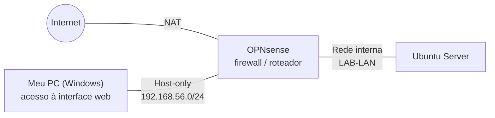

# homelab-firewall

## Sobre o projeto

Montei este laboratório no VirtualBox pra praticar na mão o que eu vinha estudando na teoria sobre redes e segurança: separar uma rede em segmentos e colocar um firewall controlando o que passa de um lado pro outro.

São duas máquinas virtuais. Uma roda o OPNsense e faz o papel de firewall e roteador. A outra é um Ubuntu Server que fica numa rede interna isolada (LAB-LAN), sem contato direto com o meu computador, então todo o tráfego dela tem que passar pelo firewall.

Documentei cada etapa, incluindo o que deu errado no caminho, porque quero que este repositório sirva de registro do que aprendi e de base pros próximos projetos de segurança que vou subir aqui.

> Projeto concluído em setembro de 2026.

## Prints

<!-- TODO: salvar os prints na pasta assets/ e trocar os nomes abaixo pelos nomes reais dos arquivos -->

| Painel do OPNsense | Interfaces configuradas |
|---|---|
|  |  |

| Regras de firewall | Ubuntu Server na LAB-LAN |
|---|---|
|  |  |

## Topologia

<!-- TODO: conferir se a WAN está mesmo em NAT e preencher o IP da LAB-LAN -->

| Interface | Placa no VirtualBox | Rede | Endereço |
|---|---|---|---|
| WAN (em0) | Adaptador 1 | NAT | DHCP do VirtualBox |
| LAN (em1) | Adaptador 2 | Somente-Anfitrião (host-only) | 192.168.56.10/24, com DHCP de .100 a .200 |
| OPT1 (em2) | Adaptador 3 | Rede interna `LAB-LAN` | PREENCHER |

## Tecnologias utilizadas

**Virtualização**
- Oracle VirtualBox, rodando no Windows

**Firewall e roteamento**
- OPNsense

**Servidor**
- Ubuntu Server

**Documentação e versionamento**
- Markdown, Git e GitHub

## O que o lab faz

- Isola o Ubuntu Server numa rede interna própria (LAB-LAN), alcançável só através do firewall
- Distribui IP por DHCP na rede de gerência (192.168.56.100 a 192.168.56.200)
- Permite acessar a interface web do OPNsense a partir do meu PC pela rede host-only
- Controla o tráfego entre as redes com regras de firewall

## Como reproduzir

### Pré-requisitos

- VirtualBox instalado
- Virtualização habilitada na BIOS/UEFI
- ISO do OPNsense
- ISO do Ubuntu Server

### Passo a passo

1. No VirtualBox, criar (ou conferir) a rede host-only na faixa `192.168.56.0/24`.
2. Criar a VM do firewall com três placas de rede: Adaptador 1 em NAT, Adaptador 2 em Somente-Anfitrião e Adaptador 3 em Rede Interna com o nome `LAB-LAN`.
3. Instalar o OPNsense e atribuir as interfaces (em0 = WAN, em1 = LAN, em2 = OPT1).
4. Configurar a LAN com IP estático `192.168.56.10/24` e ativar o DHCP na faixa `.100` a `.200`.
5. Configurar a interface OPT1 com o IP da LAB-LAN.
6. Criar a VM do Ubuntu Server com a placa de rede em Rede Interna `LAB-LAN` e instalar o sistema.
7. No navegador do PC, acessar `https://192.168.56.10` para entrar no painel do OPNsense.
8. Criar as regras de firewall e testar a comunicação entre as redes.

O detalhe de cada etapa, com prints, está na pasta [`docs/`](docs/).
<!-- TODO: conferir se a pasta da documentação se chama mesmo docs/ -->

## O que aprendi

- No começo deixei a LAN do firewall em "Rede Interna" e não conseguia acessar as VMs pelo meu PC. Foi aí que entendi na prática a diferença entre rede interna (só as VMs se enxergam) e host-only (o host também participa da rede).
- Pensei em deixar o Ubuntu Server na mesma rede host-only do OPNsense, mas isso deixaria o servidor exposto direto ao meu PC. Criei uma rede interna separada só pra ele, assim tudo que chega no servidor passa obrigatoriamente pelo firewall.
<!-- TODO: completar com o que mais você aprendeu, nas suas palavras -->

## Próximos passos

A ideia é usar este lab como base pra um projeto novo de segurança por semana, do mais simples ao mais complexo:

- **Semana 1:** análise de tráfego no Wireshark e detecção de port scan feito com nmap

## Autora

**Isabella Pinheiro Galuski da Cruz**
Estudante de Análise e Desenvolvimento de Sistemas na UFPR, estagiária de Infraestrutura de TIC e certificada CompTIA Security+.

- LinkedIn: [linkedin.com/in/SEU-PERFIL](https://www.linkedin.com/in/SEU-PERFIL)
- GitHub: [@isabella18pgdc](https://github.com/isabella18pgdc)

